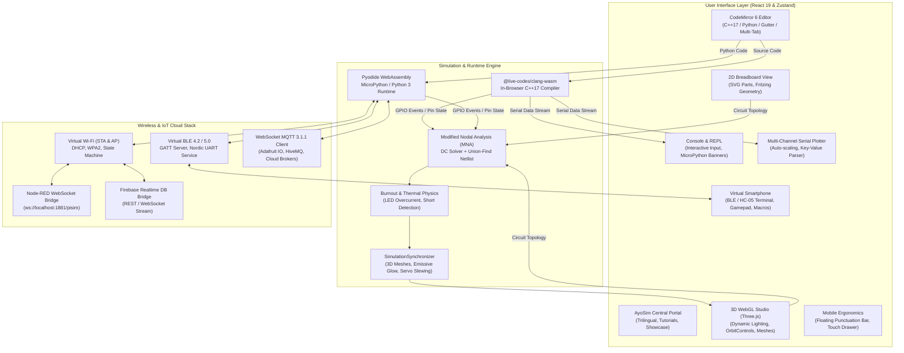
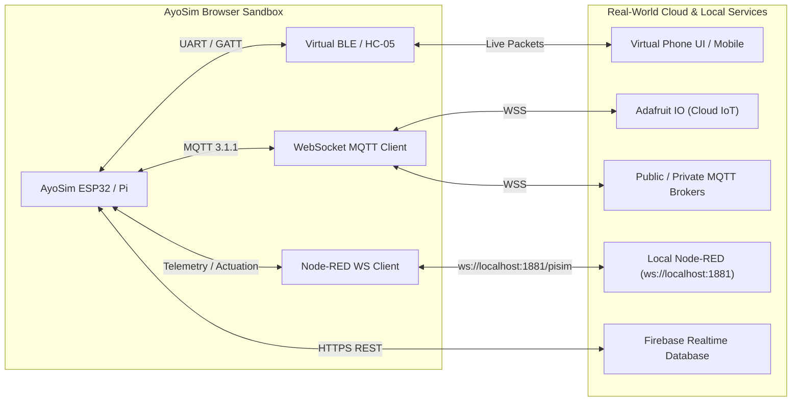

# AyoSim — Next-Generation In-Browser Hardware Simulation Ecosystem

<div align="center">

[](#license)
[-success.svg)](https://ayosim.app/)
[](https://react.dev/)
[](https://threejs.org/)
[](https://live-codes.com/)
[-purple.svg)](#internationalization-i18n--native-rtl)
[](#accessibility)

**Simulate. Learn. Build.**

*A unified, zero-install, zero-driver hardware simulation and IoT engineering platform for Arduino, ESP32, and Raspberry Pi.*

[Live Portal](https://ayosim.app/) • [AyoSim Arduino](https://arduino.ayosim.app/) • [AyoSim ESP32](https://esp32.ayosim.app/) • [AyoSim Raspberry Pi](https://rpi.ayosim.app/)

</div>

---

## Table of Contents

- [1. Executive Summary](#1-executive-summary)
- [2. Platform Architecture & High-Level Design](#2-platform-architecture--high-level-design)
- [3. The Three Core Simulators](#3-the-three-core-simulators)
  - [3.1. AyoSim Arduino (AVR & C++17 Toolchain)](#31-ayosim-arduino-avr--c17-toolchain)
  - [3.2. AyoSim ESP32 (MicroPython & Dual-Core IoT)](#32-ayosim-esp32-micropython--dual-core-iot)
  - [3.3. AyoSim Raspberry Pi (Embedded Linux & Dual GPIO)](#33-ayosim-raspberry-pi-embedded-linux--dual-gpio)
- [4. Exclusive & Differentiating Features](#4-exclusive--differentiating-features)
  - [4.1. Full Linux Raspberry Pi SBC Simulation vs Microcontroller-Only](#41-full-linux-raspberry-pi-sbc-simulation-vs-microcontroller-only)
  - [4.2. Photorealistic 3D Workbench with Dynamic LDR Studio Lighting](#42-photorealistic-3d-workbench-with-dynamic-ldr-studio-lighting)
  - [4.3. Interactive In-Browser Virtual Smartphone & Bluetooth Ecosystem](#43-interactive-in-browser-virtual-smartphone--bluetooth-ecosystem)
  - [4.4. Node-RED Bidirectional WebSocket Telemetry & Actuation Bridge](#44-node-red-bidirectional-websocket-telemetry--actuation-bridge)
  - [4.5. On-the-Fly MicroPython Firmware Catalog Switching](#45-on-the-fly-micropython-firmware-catalog-switching)
  - [4.6. Multi-Channel Serial Waveform Plotter](#46-multi-channel-serial-waveform-plotter)
  - [4.7. Electrical Burnout Physics & Destructive Safety Simulation](#47-electrical-burnout-physics--destructive-safety-simulation)
  - [4.8. Mobile-First Embedded Ergonomics & Punctuation Keyboard Bar](#48-mobile-first-embedded-ergonomics--punctuation-keyboard-bar)
  - [4.9. 100% Client-Side WebAssembly Compilation (Zero-Cloud Latency)](#49-100-client-side-webassembly-compilation-zero-cloud-latency)
  - [4.10. First-Class Trilingual Portal & Native RTL Localization](#410-first-class-trilingual-portal--native-rtl-localization)
- [5. Competitive Comparison Matrix](#5-competitive-comparison-matrix)
- [6. Comprehensive Virtual Component Library](#6-comprehensive-virtual-component-library)
- [7. Circuit Solver & Electrical Simulation Engine](#7-circuit-solver--electrical-simulation-engine)
- [8. IoT, Cloud & Wireless Connectivity Stack](#8-iot-cloud--wireless-connectivity-stack)
- [9. Curriculum, Laboratory Modules & Project Showcase](#9-curriculum-laboratory-modules--project-showcase)
- [10. Portable Project File Specification (`.ayosim.json`)](#10-portable-project-file-specification-ayosimjson)
- [11. Repository Structure & Development Guide](#11-repository-structure--development-guide)
- [12. Accessibility, Quality Assurance & Testing](#12-accessibility-quality-assurance--testing)
- [13. License & Credits](#13-license--credits)

---

## 1. Executive Summary

**AyoSim** is an advanced, 100% client-side hardware and computing simulation ecosystem developed by **AYOT**. Designed for engineering students, STEM educators, embedded software developers, and electronics hobbyists, AyoSim removes the financial, physical, and safety barriers of learning embedded electronics by delivering an interactive, physically accurate laboratory entirely within modern web browsers.

### Key Pillars
- **Zero Drivers, Zero Setup, Zero Cloud Latency**: Runs 100% client-side inside any modern browser (Chrome, Edge, Firefox, Safari) across Windows, macOS, Linux, iOS, Android, and ChromeOS. No USB driver installations, desktop software, or browser plugins required.
- **Three World-Class Computing Paradigms**: Covers the complete spectrum of embedded computing — from 8-bit bare-metal AVR microcontrollers (Arduino Uno/Nano), to 32-bit dual-core wireless IoT modules (ESP32), up to 64-bit quad-core Linux Single Board Computers (Raspberry Pi 4 Model B).
- **Dual Visual Modes (2D Schematic & 3D WebGL Studio)**: Switch seamlessly between an intuitive 2D Fritzing-style breadboard workspace and a photorealistic 3D Three.js studio featuring real-time physics, catenary jumper wires, dynamic shadows, and interactive sensors.
- **True In-Browser Toolchains**: Features an in-browser Clang/LLVM C++17 WebAssembly compiler for Arduino and a WebAssembly-based Python 3 / MicroPython execution engine for ESP32 and Raspberry Pi.
- **Complete Inclusivity & Trilingual Accessibility**: Fully localized in English, French, and Arabic (with complete Right-to-Left bidirectional layout support), adhering to WCAG 2.1 AA accessibility standards.

---

## 2. Platform Architecture & High-Level Design

AyoSim utilizes an event-driven, reactive modular architecture built on **React 19**, **TypeScript**, **Zustand**, **Three.js**, and **WebAssembly (WASM)**.



---

## 3. The Three Core Simulators

AyoSim delivers three specialized, purpose-built simulation engines:

| Characteristic | AyoSim Arduino | AyoSim ESP32 | AyoSim Raspberry Pi |
| :--- | :--- | :--- | :--- |
| **Virtual Core / Architecture** | Atmel AVR ATmega328P @ 16 MHz | Dual-core Tensilica Xtensa LX6 @ 240 MHz | Broadcom BCM2711 quad-core ARM Cortex-A72 @ 1.5 GHz |
| **Boards Emulated** | Arduino Uno R3, Arduino Nano | ESP32 DevKit V1 (30-pin & 38-pin pinouts) | Raspberry Pi 4 Model B (40-pin GPIO) |
| **Execution Toolchain** | Clang/LLVM C++17 via WebAssembly | Pyodide WebAssembly + MicroPython | Pyodide WebAssembly + Linux rootfs |
| **Programming Language** | C++17 (Native Arduino Dialect) | Python 3 / MicroPython | Python 3.11 / Bash Shell |
| **Compilation Location** | **100% Client-Side In-Browser** | **100% Client-Side In-Browser** | **100% Client-Side In-Browser** |
| **Memory Emulated** | 32 KB Flash, 2 KB SRAM, 1 KB EEPROM | 4 MB SPI Flash, 520 KB SRAM heap | 4 GB / 8 GB Virtual LPDDR4, Virtual VFS |
| **Memory Profiling** | Real WASM Code & Data Section Meter | Heap Allocation Tracking | Virtual Linux RAM / VFS disk monitoring |
| **Wireless & IoT** | Simulated HC-05 Bluetooth Module | Wi-Fi 802.11 b/g/n (STA/AP), BLE 4.2 GATT | Ethernet, Wi-Fi, BLE, Node-RED Bridge |
| **Special Hardware Features** | Internal EEPROM, PWM, 10-bit ADC, UART | Capacitive TouchPad, 8-bit DAC, FreeRTOS | 40-pin GPIO, memory-mapped pin states |

---

### 3.1. AyoSim Arduino (AVR & C++17 Toolchain)
- **URL**: [https://arduino.ayosim.app/](https://arduino.ayosim.app/)
- **Target Boards**: Arduino Uno R3 and Arduino Nano (with 1-click board switching in the UI).
- **In-Browser Clang Toolchain**: Uses `@live-codes/clang-wasm` to compile real Arduino C++ sketches directly into WebAssembly relocatable object files inside the browser. Compilation takes under 200 ms with zero backend server round-trips.
- **Physical Memory Metering**: Accurately measures Code Section (Flash) and Data Section (SRAM) byte sizes directly from WASM object bytecode headers, warning students when their sketch exceeds the ATmega328P's 32,256-byte flash or 2,048-byte SRAM boundaries.
- **Precompiled Core & Standard Libraries**:
  - `Arduino.h`: Complete GPIO manipulation (`pinMode`, `digitalWrite`, `digitalRead`, `analogRead`, `analogWrite`), timing (`delay`, `delayMicroseconds`, `millis`, `micros`), interrupts (`interrupts`, `noInterrupts`), acoustic synthesis (`tone`, `noTone`), and pulse width measurement (`pulseIn`).
  - `HardwareSerial`: Full `Serial` class supporting `begin(baud)`, `print()`, `println()`, `write()`, `available()`, and `read()`.
  - `Wire.h`: Native TwoWire I2C master implementation supporting transactions and register queries.
  - `SPI.h`: Full hardware SPI bus master protocol.
  - `Servo.h`: Software PWM generation controlling SG90 servo angle (0° to 180°).
  - `LiquidCrystal_I2C.h`: Complete HD44780 controller driver over PCF8574 I2C backpack.
  - `DHT.h`: Temperature and humidity acquisition for DHT11 and DHT22 sensors.
  - `EEPROM.h`: Persistent non-volatile memory read/write/update, serialized directly into `.ayosim.json` project files.
  - `SoftwareSerial.h`: Virtual bit-banged UART communication mapped to the HC-05 Bluetooth module.
  - Standard AVR-libc: `<avr/pgmspace.h>`, `<avr/interrupt.h>`, `<avr/io.h>`, and `<util/delay.h>`.

---

### 3.2. AyoSim ESP32 (MicroPython & Dual-Core IoT)
- **URL**: [https://esp32.ayosim.app/](https://esp32.ayosim.app/)
- **Target Architecture**: Dual-core Tensilica Xtensa LX6 @ 240 MHz on ESP32 DevKit V1.
- **MicroPython Engine**: Full MicroPython standard library emulation via Pyodide WebAssembly.
- **Hardware Abstraction Layer (`machine` Module)**:
  - `machine.Pin`: Direct pin manipulation with software and hardware pull-up/pull-down modes.
  - `machine.ADC`: 12-bit analog-to-digital conversion with configurable attenuation (0–3.6V range).
  - `machine.DAC`: True 8-bit digital-to-analog converter output on GPIO 25 and GPIO 26.
  - `machine.PWM`: Hardware-accelerated pulse-width modulation with variable frequency and duty cycle.
  - `machine.I2C`: Master I2C bus transactions.
  - `machine.TouchPad`: Capacitive touch sensor emulation with touch threshold detection.
  - `machine.Timer` & `machine.time_pulse_us`: Microsecond hardware timers and ultrasonic pulse capture.
- **Wireless Subsystems**:
  - `network`: Virtual Wi-Fi stack featuring Station (STA) and Access Point (AP) modes, simulated DHCP, IP allocation, signal strength (RSSI), and connection status callbacks (`GOT_IP`, `WRONG_PASSWORD`, `NO_AP_FOUND`).
  - `bluetooth` / `ubluetooth` / `BLE`: Full Bluetooth Low Energy peripheral emulation running the Nordic UART Service (NUS), advertisement payloads, and GATT characteristic read/write/notify.
- **Cloud IoT Protocols**: Native `umqtt.simple` and `umqtt.robust` clients, RESTful HTTP APIs via `urequests`, Adafruit IO cloud integration, and Firebase Realtime Database bridges.

---

### 3.3. AyoSim Raspberry Pi (Embedded Linux & Dual GPIO)
- **URL**: [https://rpi.ayosim.app/](https://rpi.ayosim.app/)
- **Target Architecture**: Broadcom BCM2711 quad-core ARM Cortex-A72 @ 1.5 GHz (Raspberry Pi 4 Model B).
- **Embedded Linux Environment**: Simulated Linux kernel v6.1 with a busybox/systemd virtual filesystem, interactive bash terminal, and Python 3.11 runtime.
- **Dual GPIO Library Architecture**: Unlike competing tools that force developers into a single API, AyoSim provides simultaneous, 100% compatible implementations of both:
  1. `gpiozero`: Modern, object-oriented API (`LED`, `Button`, `PWMLED`, `AngularServo`, `Buzzer`, `DistanceSensor`, `MCP3008`).
  2. `RPi.GPIO`: Legacy, register-level BCM/BOARD pin control (`GPIO.setmode`, `GPIO.setup`, `GPIO.output`, `GPIO.input`, `GPIO.PWM`).
- **Comprehensive Bus Support**: Emulated `spidev` (SPI bus master for ADC chips), `smbus` / `smbus2` (I2C bus master for sensors and displays), `board`, and `busio`.
- **Sensor Drivers Included**: Built-in support for `adafruit_dht`, `Adafruit_DHT`, `adafruit_ads1x15` (ADS1015/ADS1115), `RPLCD`, `I2C_LCD_driver`, and `requests`.

---

## 4. Exclusive & Differentiating Features

The following features are **unique to the AyoSim ecosystem** and do not exist in mainstream alternatives such as Wokwi, Autodesk Tinkercad Circuits, Proteus, or Fritzing:

```
┌──────────────────────────────────────────────────────────────────────────┐
│                     THE AYOSIM EXCLUSIVE ADVANTAGE                       │
├──────────────────────────────┬───────────────────────────────────────────┤
│ 1. Full Linux SBC Simulation │ Cortex-A72 Linux vs RP2040 Pico MCU only  │
│ 2. Dynamic LDR 3D Lighting   │ Room lighting reacts to circuit sensors   │
│ 3. Virtual Smartphone App    │ Phone with BLE/HC-05, Gamepad & Macros    │
│ 4. Node-RED WebSocket Bridge │ Live ws:// telemetry & remote GPIO action │
│ 5. Selectable Firmware MPY   │ MicroPython v1.19.1 through v1.29.0       │
│ 6. Multi-Channel Plotter     │ Real-time multi-waveform serial graphing  │
│ 7. Burnout & Safety Physics  │ LEDs turn into charred black meshes       │
│ 8. Mobile Punctuation Bar    │ One-tap embedded coding symbols on touch  │
│ 9. 100% In-Browser WASM C++  │ Zero cloud compilation latency & offline  │
│ 10. Trilingual with RTL      │ First-class English, French & Arabic      │
└──────────────────────────────┴───────────────────────────────────────────┘
```

---

### 4.1. Full Linux Raspberry Pi SBC Simulation vs Microcontroller-Only
* **The Competition's Limitation**: Popular browser simulators (such as Wokwi) only simulate the **Raspberry Pi Pico** (the RP2040/RP2350 microcontroller). They cannot run Linux, have no Linux shell, cannot run standard desktop Python packages, and lack the Broadcom BCM2711 architecture. Tinkercad has zero Raspberry Pi support.
* **The AyoSim Innovation**: AyoSim simulates a complete **Raspberry Pi 4 Single Board Computer (SBC)**. Students experience real Linux-style programming with an interactive bash shell, virtual filesystem, and Python 3.11 runtime interacting with a memory-mapped 40-pin GPIO header.

---

### 4.2. Photorealistic 3D Workbench with Dynamic LDR Studio Lighting
* **The Competition's Limitation**: Tinkercad uses a fixed 2.5D schematic view. Wokwi relies on 2D flat SVG diagrams. Desktop simulators use sterile CAD wireframes.
* **The AyoSim Innovation**: AyoSim integrates a full **Three.js WebGL 3D Studio** with smooth OrbitControls (pan, zoom, orbit).
* **Sensor-Reactive Ambient Studio Lighting**: The 3D studio ambient and directional lighting is dynamically coupled to the circuit's simulated LDR (photoresistor). When a user covers or dims the LDR, the virtual room physically darkens in real-time, allowing active circuit LEDs to cast realistic emissive glows and point-light halos across the breadboard.
* **Physical Realism**: Features curved catenary DuPont jumper wires with realistic droop, molded nylon connector sleeves with strain relief, height offsets for elevated header sockets and screw terminals, animated SG90 servo horns, spinning fan blades, and live LCD 1602 text rendered directly onto 3D screen textures.

---

### 4.3. Interactive In-Browser Virtual Smartphone & Bluetooth Ecosystem
* **The Competition's Limitation**: No other hardware simulator includes an interactive, photorealistic smartphone inside the simulation workbench.
* **The AyoSim Innovation**: AyoSim incorporates a dockable, draggable virtual smartphone running realistic mobile companion apps:
  - **AyoSim Arduino (HC-05 Bluetooth)**: Emulates a classic Bluetooth connection to a breadboard-mounted HC-05 module. Includes PIN pairing (`1234`), a bidirectional serial terminal, a customizable 6-button gamepad controller (sending configurable ASCII bytes like `'A'`, `'B'`), and a 0–255 PWM slider.
  - **AyoSim ESP32 (BLE Terminal)**: Emulates a professional BLE Serial Terminal app (modeled after Kai Morich's Serial Bluetooth Terminal). Features classic vs. BLE scanning with live RSSI signal bars, GATT connection lifecycles, and customizable macro buttons (M1–M6) supporting text, raw hex, and auto-repeating transmissions.

---

### 4.4. Node-RED Bidirectional WebSocket Telemetry & Actuation Bridge
* **The Competition's Limitation**: Web simulators exist in an isolated sandbox and cannot communicate with industrial IoT orchestration tools without complex third-party tunneling.
* **The AyoSim Innovation**: AyoSim includes a native, bidirectional WebSocket bridge (`ws://localhost:1881/pisim` via `node-red-contrib-pisim`):
  - **Telemetry Streaming**: Live simulated sensor readings (DHT temperature/humidity, HC-SR04 ultrasonic distance, LDR illumination level, potentiometer position) are broadcast continuously as JSON payloads to local or remote Node-RED flows.
  - **Remote Hardware Actuation**: Node-RED can inject GPIO setup, digital write, and PWM events back into the browser simulation, allowing students to build industrial IoT dashboards and automation workflows without physical hardware.

---

### 4.5. On-the-Fly MicroPython Firmware Catalog Switching
* **The Competition's Limitation**: Other platforms fix the runtime to a single arbitrary interpreter version with no visibility into firmware differences.
* **The AyoSim Innovation**: AyoSim ESP32 provides a **Firmware Version Catalog**, allowing developers to switch between 6 official MicroPython releases on the fly:
  - `v1.29.0` (Latest), `v1.25.0`, `v1.24.1`, `v1.23.0`, `v1.22.0`, and `v1.19.1` (Legacy).
  - Dynamically updates the REPL boot banner and `.mpy` bytecode format compatibility, allowing students to reproduce version-specific behaviors and test firmware migrations.

---

### 4.6. Multi-Channel Serial Waveform Plotter
* **The Competition's Limitation**: Most simulators only offer a basic scrolling text console or a rudimentary single-line plotter.
* **The AyoSim Innovation**: AyoSim includes an intelligent, multi-channel **Serial Plotter** running alongside the text console:
  - Plots up to **6 simultaneous color-coded waveform channels**.
  - **Intelligent Stream Parsing**: Automatically detects and graphs single numbers (`512`), comma/tab/space-separated values (`10, 20, 30`), and key-value formats (`temp:24.5 hum:55.0`).
  - Dynamic auto-scaling Y-axis with tick labels, configurable baud rates (300 to 115,200 baud), and selectable line endings (None, NL, CR, CRLF).

---

### 4.7. Electrical Burnout Physics & Destructive Safety Simulation
* **The Competition's Limitation**: Many simulators allow users to connect an LED directly to 5V or reverse-bias power rails with no consequence, reinforcing dangerous real-world wiring habits.
* **The AyoSim Innovation**: AyoSim implements strict physical safety equations:
  - **LED Overcurrent Burnout**: If current through an LED exceeds its maximum allowable threshold ($I_{\max} = 30\text{ mA}$), the LED permanently burns out, transforming into an open circuit. In the 3D Studio, the LED mesh physically transforms into a **burnt charcoal mesh** with extinguished illumination.
  - **Short Circuit Detection**: The solver continuously checks for conflicting ideal voltage sources shorted to common nets, issuing visual warning banners and safeguarding user circuits.

---

### 4.8. Mobile-First Embedded Ergonomics & Punctuation Keyboard Bar
* **The Competition's Limitation**: Standard web simulators are virtually unusable on smartphones and tablets because mobile software keyboards hide essential programming symbols behind multiple sub-menus.
* **The AyoSim Innovation**: AyoSim features an adaptive mobile layout:
  - **Floating Programming Keyboard Bar**: Provides immediate, one-tap access to critical embedded syntax: `{`, `}`, `(`, `)`, `[`, `]`, `;`, `:`, `=`, `"`, `'`, `_`, `\t`, and indentation controls.
  - **Touch-Optimized Component Drawer**: Allows effortless component spawning and wire placement via multi-touch gestures on mobile screens.

---

### 4.9. 100% Client-Side WebAssembly Compilation (Zero-Cloud Latency)
* **The Competition's Limitation**: Most browser-based Arduino simulators transmit user C++ code across the internet to a remote Dockerized GCC backend server for compilation, introducing latency, server queue delays, and privacy concerns.
* **The AyoSim Innovation**: AyoSim compiles real C++17 into WebAssembly **locally on the user's device** using `@live-codes/clang-wasm`. Sketch compilation occurs in milliseconds, functions completely offline, guarantees 100% student data privacy, and requires zero cloud infrastructure costs.

---

### 4.10. First-Class Trilingual Portal & Native RTL Localization
* **The Competition's Limitation**: Existing tools are either English-only or provide automated, poorly formatted machine translations that break layout orientation.
* **The AyoSim Innovation**: AyoSim features human-curated localization across **English (`en`)**, **French (`fr`)**, and **Arabic (`ar`)**:
  - The Arabic localization incorporates full **Right-to-Left (RTL)** layout mirroring, including reversed navigation drawers, mirrored sidebars, adapted toolbar controls, and localized technical typography.

---

## 5. Competitive Comparison Matrix

| Technical Feature | AyoSim Ecosystem | Wokwi | Autodesk Tinkercad | Proteus VSM | Fritzing |
| :--- | :---: | :---: | :---: | :---: | :---: |
| **Deployment Mode** | 100% In-Browser (WASM) | 100% In-Browser | Cloud Web App | Desktop Install (Win) | Desktop Install |
| **Account / Login Required** | **No (Instant Access)** | No (Freemium) | **Yes (Account Wall)** | Yes (Commercial) | Yes (Paid Download) |
| **Arduino Simulation** | ✅ AVR ATmega328P | ✅ AVR ATmega328P | ✅ AVR ATmega328P | ✅ AVR ATmega328P | ❌ Schematic Only |
| **ESP32 Simulation** | ✅ Dual-Core + MicroPython | ✅ Dual-Core | ❌ None | ❌ None | ❌ Schematic Only |
| **Raspberry Pi Full SBC (Linux)**| **✅ Yes (Cortex-A72)** | ❌ (RP2040 Pico Only) | ❌ None | ❌ None | ❌ Schematic Only |
| **In-Browser C++ Compilation** | **✅ Clang-WASM (Local)** | ❌ Remote Server | ❌ Remote Server | N/A (Desktop) | N/A |
| **3D Photorealistic View** | **✅ Three.js WebGL** | ❌ 2D SVG Only | ⚠️ 2.5D Stylized | ⚠️ 3D CAD Enclosure | ❌ 2D Only |
| **Dynamic LDR Studio Lighting** | **✅ Yes (Real-Time)** | ❌ None | ❌ None | ❌ None | ❌ None |
| **Virtual Smartphone Integration** | **✅ Yes (BLE & HC-05)** | ❌ None | ❌ None | ❌ None | ❌ None |
| **Node-RED Telemetry Bridge** | **✅ Yes (Bidirectional)**| ❌ None | ❌ None | ❌ None | ❌ None |
| **MicroPython Firmware Switcher** | **✅ v1.19.1–v1.29.0** | ❌ None | ❌ None | ❌ None | ❌ None |
| **Multi-Channel Serial Plotter** | **✅ Up to 6 Waveforms** | ⚠️ Basic Single | ❌ None | ⚠️ Virtual Scope | ❌ None |
| **Destructive Burnout Physics** | **✅ Yes (Charcoal Mesh)**| ⚠️ Visual Warning | ⚠️ Explosion Icon | ❌ Model Breakdown | ❌ None |
| **Mobile Programming Keyboard** | **✅ Floating Symbol Bar**| ❌ None | ❌ None | ❌ Desktop Only | ❌ Desktop Only |
| **Multilingual + Native RTL** | **✅ EN / FR / AR (RTL)** | ❌ English Only | ⚠️ Partial (LTR) | ❌ English Only | ⚠️ Community Translations |
| **Open Project Format** | **✅ Portable JSON** | ⚠️ Proprietary | ⚠️ Closed Cloud | ⚠️ Binary Design | ⚠️ XML/FZZ |

---

## 6. Comprehensive Virtual Component Library

AyoSim features a standardized, expanding library of electronic components modeled with accurate geometric terminals, internal resistance, and electrical state characteristics:

```
├── Microcontrollers & Boards
│   ├── Arduino Uno R3 (ATmega328P, 14 digital I/O, 6 PWM, 6 ADC, UART, 5V/3.3V)
│   ├── Arduino Nano (Compact breadboard footprint, 8 ADC channels)
│   ├── ESP32 DevKit V1 (30-pin & 38-pin pinouts, Wi-Fi, BLE, Touch, DAC)
│   └── Raspberry Pi 4 Model B (40-pin GPIO header, 3.3V logic, I2C/SPI buses)
├── Prototyping Surfaces
│   └── Half-Size Breadboard (400 tie points, dual positive/negative power rails)
├── Discrete Components & Actuators
│   ├── LEDs (Red, Green, Blue, Yellow, Orange, White; current curve & burnout physics)
│   ├── Carbon Film Resistors (4-band and 5-band EIA color code calculation, 1Ω to 10MΩ)
│   ├── Momentary Push Buttons (Tactile switch with active-high/low pull support)
│   ├── Active & Passive Buzzers (Acoustic frequency and tone() sound generation)
│   ├── SG90 Micro Servo (PWM-controlled angle articulation 0°–180°)
│   ├── 5V SPDT Relay Module (Optocoupler driver, NO/COM/NC screw terminals)
│   └── 5V DC Brushless Cooling Fan (Dynamic RPM visualization)
├── Analog & Digital Sensors
│   ├── HC-SR04 Ultrasonic Distance Sensor (Microsecond echo timing, 2 cm–400 cm)
│   ├── DHT11 & DHT22 Environmental Sensors (Temperature & Relative Humidity)
│   ├── Light Dependent Resistor (LDR / Photoresistor, 0–100% illumination)
│   ├── LDR Module with LM393 Comparator (Digital DO threshold + Analog AO)
│   └── Rotary Potentiometer (10 kΩ linear voltage divider)
├── Integrated Circuits & Converters
│   ├── MCP3008 (8-Channel 10-Bit SPI Analog-to-Digital Converter)
│   ├── ADS1115 (4-Channel 16-Bit I2C High-Precision ADC with Programmable Gain)
│   └── PCF8574 (I2C 8-Bit I/O Expander Backpack for LCD Displays)
├── Displays & Human-Machine Interfaces
│   └── HD44780 1602 Character LCD (Direct 4-bit/8-bit parallel and I2C backpack)
└── Power & Communication Modules
    ├── Variable Bench DC Power Supply (Adjustable voltage binding posts)
    └── HC-05 Bluetooth Serial Module (UART wireless AT-command bridge)
```

---

## 7. Circuit Solver & Electrical Simulation Engine

At the core of AyoSim is a custom, deterministic electrical simulation engine optimized for high-frequency browser execution:

### 1. Topology & Net Construction (Disjoint-Set Union-Find)
- Component terminals, breadboard tie points, and jumper wire endpoints are resolved onto a 2D/3D coordinate grid.
- A **Union-Find with path compression** algorithm constructs connected electrical nets across all wires and internal component links in near-constant time $\mathcal{O}(\alpha(N))$.

### 2. Modified Nodal Analysis (MNA) DC Solver
- The engine computes node voltages using Modified Nodal Analysis:
  $$\mathbf{G} \cdot \mathbf{v} = \mathbf{i}$$
- **Ideal Voltage Supplies ($V$)**: Ground rails ($0\text{V}$), $3.3\text{V}$, and $5.0\text{V}$ supplies clamp their connected nets to fixed potentials.
- **Thevenin Source Modeling ($N$)**: Microcontroller GPIO outputs are modeled as real Thevenin sources (e.g. AVR GPIO driver resistance $R_{\text{out}} \approx 25\,\Omega$, internal pull-up resistance $R_{\text{pullup}} \approx 35\,\text{k}\Omega$).
- **Non-Linear Diode Modeling ($D$)**: LEDs and diodes are simulated using a piecewise linear model with forward voltage $V_f$ and dynamic forward resistance $R_{\text{on}}$:
  $$I_D = \begin{cases} 0, & V_A - V_K < V_f \\ \frac{V_A - V_K - V_f}{R_{\text{on}}}, & V_A - V_K \ge V_f \end{cases}$$
- **Piecewise Iteration**: The solver iteratively re-evaluates diode conducting states until net voltages and branch currents converge.

### 3. Dynamic Physical Effects
- **LED Brightness Curve**: LED luminous intensity is scaled across forward current:
  $$B = \min\left(1.0, \frac{I_{\text{mA}}}{I_{\text{full}}} \times 2.0\right)$$
- **Burnout Trigger**: If current exceeds $I_{\max} = 30\text{ mA}$, the component burns out, transitioning permanently into an open circuit.

---

## 8. IoT, Cloud & Wireless Connectivity Stack

AyoSim bridges the gap between simulated hardware and real cloud IoT infrastructure:



1. **Virtual Wi-Fi (802.11 b/g/n)**: Simulates the ESP32 network stack with configurable SSIDs, authentication modes (Open, WPA2-PSK), IP address assignment, and realistic connection latency.
2. **Bluetooth Low Energy & Nordic UART**: Exposes GATT services and characteristics for wireless telemetry and remote control.
3. **WebSocket MQTT 3.1.1 Client**: Speaks genuine MQTT over secure WebSockets (`wss://`), allowing direct connections to Adafruit IO, HiveMQ, and EMQX.
4. **Node-RED Bridge**: Seamlessly links virtual sensors to Node-RED visual flows on the user's local machine via WebSocket port `1881`.

---

## 9. Curriculum, Laboratory Modules & Project Showcase

AyoSim comes pre-loaded with **over 50 structured, curriculum-aligned laboratory experiments** that load a complete circuit, wiring layout, and tested sample code in one click:

### Curated Laboratory Highlights
* **AyoSim Arduino**:
  * `Lab 1`: Blink & External LED (D13 current analysis)
  * `Lab 2`: Traffic Light Controller with Pedestrian Pushbutton
  * `Lab 3`: Potentiometer PWM Dimmer & Real-Time Serial Plotter
  * `Lab 4`: Automatic Night-Light with LDR Sensor
  * `Lab 5`: SG90 Micro Servo Control (`<Servo.h>`)
  * `Lab 6`: Ultrasonic Parking Radar with Buzzer Tone (`tone()`)
  * `Lab 7`: Digital Weather Station (DHT22 Sensor + I2C LCD 1602)
  * `Lab 8`: 10-Bit SPI ADC Interfacing with MCP3008 (`<SPI.h>`)
  * `Lab 9`: 16-Bit High-Precision Voltmeter with ADS1115 (`<Wire.h>`)
  * `Lab 10`: Thermostat Relay Controller with Persistent EEPROM Storage
* **AyoSim ESP32**:
  * `TP 1`: MicroPython GPIO Output & Heartbeat LED
  * `TP 3`: 12-Bit Analog Input & LDR Calibration
  * `TP 4`: True Analog Output via 8-Bit DAC (GPIO 25/26)
  * `TP 5`: Ultrasonic Pulse Timing with `machine.time_pulse_us`
  * `TP 6`: Capacitive Touch Sensor Detection with `machine.TouchPad`
  * `TP 9`: Cloud IoT Telemetry Publishing to Adafruit IO
  * `TP 10`: Firebase Realtime Database Telemetry Bridge
  * `TP 12`: BLE Nordic UART Terminal & Virtual Smartphone Gamepad
* **AyoSim Raspberry Pi**:
  * `Lab 2.1–2.4`: `gpiozero` vs `RPi.GPIO` comparative programming
  * `Lab 3.1–3.3`: Hardware SPI ADC with `spidev` and I2C ADC with CircuitPython
  * `Lab 4.1–4.2`: Ultrasonic pulse measurement and DHT temperature logging
  * `Lab 5.1–5.2`: I2C HD44780 LCD display driver with `RPLCD`
  * `Lab 6.1–6.3`: Cloud IoT dashboards and cooling fan automation via MQTT

---

## 10. Portable Project File Specification (`.ayosim.json`)

AyoSim uses a clean, human-readable, versioned JSON format (`.ayosim.json`) to persist circuits, code, custom libraries, and virtual hardware state:

```json
{
  "app": "ayosim",
  "version": 1,
  "platform": "arduino",
  "boardType": "uno-r3",
  "name": "Smart-Thermostat",
  "savedAt": "2026-11-24T14:00:00.000Z",
  "code": "// Arduino sketch C++ code\n#include <LiquidCrystal_I2C.h>\n...",
  "doc": {
    "parts": [
      { "id": "uno", "type": "arduino", "x": 100, "y": 150, "rot": 0, "props": { "boardType": "uno-r3" } },
      { "id": "bb", "type": "breadboard", "x": 420, "y": 150, "rot": 0, "props": {} },
      { "id": "led1", "type": "led", "x": 510, "y": 180, "rot": 0, "props": { "color": "green" } },
      { "id": "r1", "type": "resistor", "x": 510, "y": 240, "rot": 90, "props": { "ohms": 220 } }
    ],
    "wires": [
      { "id": "w1", "from": "uno:pin_13", "to": "bb:t_24_a", "color": "blue" },
      { "id": "w2", "from": "bb:t_24_b", "to": "led1:a", "color": "green" }
    ]
  },
  "config": {
    "spi": true,
    "i2c": true
  },
  "eeprom": {
    "0": 42,
    "1": 100
  },
  "libs": [
    {
      "name": "custom_filter.h",
      "content": "#pragma once\nfloat lowPass(float in) { return in * 0.1f; }"
    }
  ]
}
```

---

## 11. Repository Structure & Development Guide

The AyoSim ecosystem is organized into a modular monorepo structure:

```
opencode/
├── Ayosim/                     # Primary Platform Portal & Documentation
│   ├── index.html              # Central showcase, tutorials, and simulator launcher
│   ├── css/                    # Design system (variables, responsive, layout, RTL)
│   ├── js/                     # Portal interactivity, theme, filter animations
│   ├── i18n/                   # en.json, fr.json, ar.json (Trilingual translations)
│   └── README.md               # Canonical platform documentation
├── Arduino Sim/                # AyoSim Arduino Simulator
│   ├── src/
│   │   ├── arduino/            # Clang-WASM compiler, runner, protocol, plotter
│   │   ├── circuit/            # MNA electrical solver, parts registry, HD44780
│   │   ├── hardware/           # ATmega328P pinouts, Arduino Uno & Nano specs
│   │   ├── ui/                 # React 19 UI, CodeMirror 6, Serial Plotter
│   │   │   ├── phone/          # Virtual Smartphone (HC-05, Gamepad, Slider)
│   │   │   ├── mobile/         # Mobile touch drawer & punctuation keyboard bar
│   │   │   └── workbench3d/    # Three.js 3D studio, LDR dynamic lighting, catenary wires
│   │   └── labs/               # 10+ Arduino laboratory templates
│   └── package.json            # Vite, React 19, Three.js, @live-codes/clang-wasm
├── Esp Sim/                    # AyoSim ESP32 Simulator
│   ├── src/
│   │   ├── python/             # Pyodide runner, worker, and MicroPython shims
│   │   ├── iot/                # Virtual Wi-Fi, BLE 4.2 stack, MQTT, Node-RED bridge
│   │   ├── hardware/           # ESP32 pinouts & MicroPython firmware version catalog
│   │   ├── ui/phone/           # Serial Bluetooth Terminal app (BLE scanning, macros)
│   │   └── ui/workbench3d/     # 3D ESP32 model & animated actuators
│   └── package.json            # Vite, React 19, Three.js, Pyodide
└── Rpi Sim/                    # AyoSim Raspberry Pi Simulator
    ├── src/
    │   ├── python/             # Pyodide Linux runner & shims (gpiozero, RPi.GPIO)
    │   ├── iot/                # BLE, MQTT, Node-RED bridge
    │   ├── ui/                 # Interactive Linux terminal & 40-pin GPIO board
    │   └── ui/workbench3d/     # 3D Raspberry Pi 4 Model B studio
    └── package.json            # Vite, React 19, Three.js, Pyodide
```

### Local Development Setup

To run any of the simulator applications locally:

```bash
# Clone the repository
git clone https://github.com/AYOT/ayosim.git
cd ayosim

# 1. Run the AyoSim Portal
cd Ayosim
npx serve -l 8080

# 2. Run AyoSim Arduino
cd "../Arduino Sim"
npm install
npm run dev

# 3. Run AyoSim ESP32
cd "../Esp Sim"
npm install
npm run dev

# 4. Run AyoSim Raspberry Pi
cd "../Rpi Sim"
npm install
npm run dev
```

---

## 12. Accessibility, Quality Assurance & Testing

AyoSim maintains comprehensive testing suites across unit, integration, and end-to-end levels:

- **Vitest Unit & Integration Suites**: Rigorously validates circuit solver convergence, MNA math, Clang-WASM compilation output, MicroPython shims, BLE advertising packets, and MQTT serialization.
- **Playwright End-to-End Tests**: Simulates full user journeys across desktop and mobile viewports, including component drag-and-drop, wiring, sketch execution, and virtual smartphone pairing.
- **Accessibility (WCAG 2.1 AA)**: Includes screen-reader skip links, ARIA live regions for console outputs, high-contrast dark/light color tokens, keyboard navigation throughout the breadboard, and reduced-motion support.

---

## 13. License & Credits

**AyoSim** is conceptualized, engineered, and maintained by **AYOT**.

* Copyright © 2026 AYOT. All rights reserved.
* Built with [React 19](https://react.dev/), [Three.js](https://threejs.org/), [CodeMirror 6](https://codemirror.net/), [Zustand](https://github.com/pmndrs/zustand), [Pyodide](https://pyodide.org/), and [@live-codes/clang-wasm](https://github.com/live-codes/clang-wasm).
